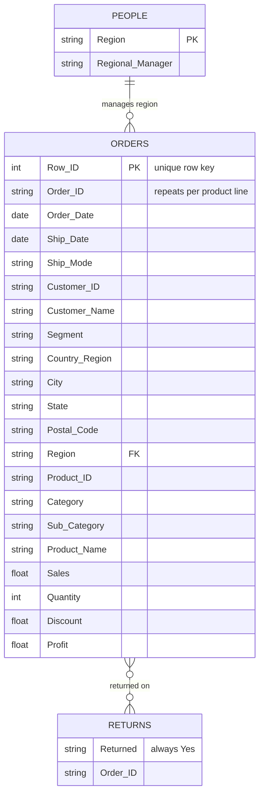

# Data Structure Overview
### Superstore Sales Performance

[← Back to project overview](../README.md)

---

## Contents
[Source](#source) · [At a Glance](#at-a-glance) · [Tables](#tables) · [Relationships](#relationships) · [Data Dictionary](#data-dictionary) · [Data Quality Notes](#data-quality-notes) · [Original ERD](#original-erd)

---

## Source

- **Dataset:** Sample – Superstore, the sample workbook that ships with Tableau Desktop
- **Connection:** Tableau **extract** (not a live connection)
- **Tables:** Orders, Returns, and People
- **Where to find it:** the data extract is packaged inside the [Tableau workbooks](../Tableau). The copy of `sample_superstore.xls` in this folder is currently empty (see [Data Quality Notes](#data-quality-notes)).

---

## At a Glance

| Measure | Value |
|---|---|
| Order line items (rows) | **9,994** |
| Unique orders | **5,009** |
| Customers | **793** |
| Products | **1,849** |
| Order dates | **Jan 3, 2018 – Dec 30, 2021** |
| Geography | United States · 4 regions · 49 states · 531 cities |
| Segments | Consumer · Corporate · Home Office |
| Categories | Furniture · Office Supplies · Technology (17 sub-categories) |
| Ship modes | Same Day · First Class · Second Class · Standard Class |
| Total sales | **$2,297,200.86** |
| Total profit | **$286,397.02** (12.47% profit ratio) |
| Units sold | 37,873 |
| Returned orders | **296** orders, covering **800** line items |

*Figures were calculated directly from the data extract in the Tableau workbook.*

---

## Tables

| Table | Rows | Grain (one row per…) | Role |
|---|---|---|---|
| **Orders** | 9,994 | Product line within an order | Fact table: every sale with its sales, quantity, discount, and profit |
| **Returns** | 800 | Returned order line | Flags which orders were returned (`Returned = Yes`) |
| **People** | 4 | Region | Lookup: the regional manager for each region |

**Important:** an order can contain many products (up to 14 lines), so **Order ID is not unique in Orders**. Each row is one product line within an order.

---

## Relationships



| Link | Join key | Cardinality | Notes |
|---|---|---|---|
| **People → Orders** | `Region` | One-to-many | Each of the 4 regions has one manager and many orders |
| **Returns → Orders** | `Order ID` | Many-to-many at the row level | Both tables list an order once per product line, so join carefully (see below) |

**In Tableau,** the tables are linked with relationships: Orders ↔ People on `Region`, and Orders ↔ Returns on `Order ID`.

**Joining Returns safely:** because `Order ID` repeats in both tables, a plain SQL join would multiply rows. Use the distinct list of returned orders instead:

```sql
SELECT o.*,
       CASE WHEN r.order_id IS NOT NULL THEN 'Yes' ELSE 'No' END AS returned
FROM orders o
LEFT JOIN (SELECT DISTINCT order_id FROM returns) r
       ON o.order_id = r.order_id;
```

---

## Data Dictionary

### Orders

*Examples come from one real row: a discounted table order that lost money.*

| Field | Type | Description | Example |
|---|---|---|---|
| Row ID | Integer | Unique row number (primary key) | 1 |
| Order ID | Text | Order identifier; repeats for each product in the order. Format: country–year–number | CA-2018-100090 |
| Order Date | Date | Date the order was placed | 2018-07-08 |
| Ship Date | Date | Date the order shipped | 2018-07-12 |
| Ship Mode | Text | Same Day, First Class, Second Class, or Standard Class | Standard Class |
| Customer ID | Text | Customer identifier | — |
| Customer Name | Text | Customer's name | — |
| Segment | Text | Consumer, Corporate, or Home Office | Corporate |
| Country/Region | Text | Always United States | United States |
| City | Text | Ship-to city | — |
| State | Text | Ship-to state | California |
| Postal Code | Text | ZIP code; store as text to keep leading zeros | 94122 |
| Region | Text | Central, East, South, or West (links to People) | West |
| Product ID | Text | Product identifier | — |
| Category | Text | Furniture, Office Supplies, or Technology | Furniture |
| Sub-Category | Text | 17 groups, such as Tables, Phones, and Chairs | Tables |
| Product Name | Text | Product description | — |
| Sales | Decimal | Sales amount for the line, in dollars | 502.49 |
| Quantity | Integer | Units sold | 3 |
| Discount | Decimal | Discount as a fraction, from 0 to 0.8 (0.2 = 20% off) | 0.2 |
| Profit | Decimal | Profit for the line, in dollars; negative means a loss | −87.94 |

*Row ID, Customer ID, and Product ID are in the source file but were left out of the Tableau extract because the dashboard doesn't use them.*

### Returns

| Field | Type | Description |
|---|---|---|
| Returned | Text | Always "Yes" |
| Order ID | Text | The returned order; listed once per product line in that order |

### People

| Field | Type | Description |
|---|---|---|
| Region | Text | Central, East, South, or West (primary key) |
| Regional Manager | Text | Manager responsible for the region |

---

## Data Quality Notes

| Check | Result | What it means |
|---|---|---|
| **Missing Postal Codes** | 11 rows | Doesn't affect state-level or regional analysis |
| **Ship date before order date** | 0 rows | Dates are consistent |
| **Returns without a matching order** | 0 | Every returned order exists in Orders |
| **Loss-making rows** (profit < 0) | 1,871 rows (18.7%) | Expected; these drive the discounting findings |
| **Possible duplicate rows** | 2 rows | Same order, product, date, and amounts; worth a check, but too few to change results |
| **Discount stored as a fraction** | 0 to 0.8 | Format as a percentage in reports |
| **Source file in this repo** | `sample_superstore.xls` is empty (2 bytes) | Re-upload the original workbook so others can reproduce the analysis |

---

## Original ERD

The diagram below was drawn at the start of the project. The [Relationships](#relationships) section above reflects what profiling the data showed. Key differences:

- **Orders' primary key is Row ID, not Order ID**, because Order ID repeats for each product in an order.
- **People links to Orders on Region only.** It has no Order ID field.
- **Returns' key field is Order ID.** "Returned" is a Yes flag, not a key.
- **Discount is a decimal** (for example, 0.2), not an integer.


