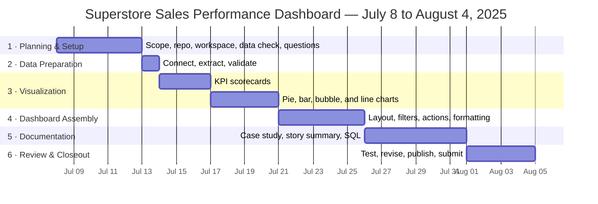

# Project Management Overview
### Superstore Sales Performance Dashboard

[← Back to project overview](../README.md)

I ran this analysis as a formal project: requirements, scope, a work breakdown structure, a schedule, risks, and success criteria. This page summarizes that plan. The full details are in the documents linked below.

---

## Contents
[At a Glance](#at-a-glance) · [Documents](#documents) · [Scope](#scope) · [Schedule](#schedule) · [Deliverables](#deliverables) · [Roles](#roles) · [Risks](#risks) · [Communication](#communication) · [Success Criteria](#success-criteria) · [Closure](#closure)

---

## At a Glance

| | |
|---|---|
| **Goal** | Build an interactive Tableau dashboard that shows Superstore's sales performance and supports data-driven decisions |
| **Duration** | **28 days** · July 8 – August 4, 2025 |
| **Structure** | 6 phases · 27 tasks, each with dependencies, dates, and an owner |
| **Team** | Solo: I served as sponsor, project manager, business analyst, Tableau developer, and QA |
| **Tools** | Smartsheet (WBS and schedule) · Tableau Desktop and Tableau Public · Excel · GitHub |

---

## Documents

| Document | What it covers |
|---|---|
| 📋 [Business Requirements](Business%20Requirement/Capstone%20Project%20-%20Superstore%20Sales%20Performance%20Business%20Requirements.pdf) | Eight dashboard views, filters, colors, tooltips, and layout, captured as requirements meeting notes (July 8, 2025) |
| 📑 [Project Management Plan](PM%20Plan/SSP_Dashboard_Project_Plan.pdf) | Scope, deliverables, stakeholders, timeline, resources, risks, communication, success metrics, and closure (v1.1) |
| 🗂️ [Work Breakdown Structure](WBS/Superstore_Sale_Performance_Dashboard_WBS.xlsx) | Every task with predecessors, duration, dates, and owner (Smartsheet export) |
| 🎥 [WBS & Timeline Walkthrough](https://youtu.be/t5fny7NXkSs) | A video tour of the plan and schedule |

---

## Scope

| ✅ In scope | ❌ Out of scope |
|---|---|
| Connect to the Sample Superstore data | Extensive data cleaning or ETL beyond basic preparation in Tableau |
| Build every view in the requirements | Live data connections |
| Assemble the dashboard with the required layout, filters, and actions | Statistical modeling or prediction beyond trend analysis |
| Format all elements to the specification | Production deployment or maintenance (beyond Tableau Public) |
| Hide the working sheets and prepare for publishing | Building a custom database or application |
| Document the project: case study, story summary, SQL examples, README | |

**Key requirements:** four KPI scorecards (Total Sales, Total Profit, Total Volume, Sales per Customer), sales by region (pie), Top N states (bar with an adjustable parameter), sales by sub-category (bubbles), and a monthly sales trend (line). Filters for order date, segment, ship mode, and state. The pie and bubble charts act as filters. Fixed size: 1055 × 850.

---

## Schedule

| # | Phase | Dates | Days | Key tasks |
|---|---|---|---|---|
| 1 | **Planning & Setup** | Jul 8 – 12 | 5 | Define scope and requirements · set up GitHub and Smartsheet · verify data · set up Tableau · write the business questions |
| 2 | **Data Preparation** | Jul 13 | 1 | Connect to the data and create an extract · basic validation |
| 3 | **Visualization Development** | Jul 14 – 20 | 7 | KPI scorecards · sales by region · Top N states · sales by sub-category · sales trend |
| 4 | **Dashboard Assembly** | Jul 21 – 25 | 5 | Layout and containers · add sheets · filters · chart actions · formatting · hide sheets |
| 5 | **Documentation** | Jul 26 – 31 | 6 | Case study · Tableau story summary · SQL queries |
| 6 | **Review & Closeout** | Aug 1 – 4 | 4 | Test · address feedback · publish to Tableau Public · update README · submit |

---

## Deliverables

| # | Deliverable | Where to find it |
|---|---|---|
| 1 | Tableau dashboard workbook | [Workbook](../Tableau/Superstore%20Sales%20Performance.twbx) · [Tableau Public](https://public.tableau.com/shared/MP44DZ8ZT?%3Adisplay_count=n&%3Aorigin=viz_share_link) |
| 2 | Case study | [PDF](../Case%20Study/Case%20Study-%20Optimizing%20Superstore%20Sales%20Performance%20for%20Enhanced%20Profitability.pdf) |
| 3 | Tableau story | [Workbook](../Tableau/Superstore%20Sales%20Performance%20Case%20Study.twbx) · [Tableau Public](https://public.tableau.com/views/SuperstoreSalesPerformanceCaseStudy/SuperstoreSalesPerformanceCaseStudy?%3Alanguage=en-US&publish=yes&%3Asid=&%3Aredirect=auth&%3Adisplay_count=n&%3Aorigin=viz_share_link) |
| 4 | GitHub README | [README](../README.md) |
| 5 | Project management plan, requirements, and WBS | [See Documents](#documents) |

---

## Roles

As a solo project, I held every role. Separating them in the plan kept each type of work clear.

| Role | Responsibility |
|---|---|
| **Sponsor** | Set direction and approved final deliverables |
| **Project Manager** | Planned, tracked, and closed the project |
| **Business Analyst** | Defined requirements and business questions; analyzed the data |
| **Tableau Developer** | Built the views and dashboard |
| **QA** | Tested functionality and data accuracy |
| **End users** | Business stakeholders who use the dashboard for sales insights |

---

## Risks

| Risk | Likelihood | Impact | Mitigation |
|---|---|---|---|
| Data inconsistencies or errors | Low | Medium | Basic validation checks during data preparation |
| Tableau technical challenges | Medium | Medium | Tableau documentation and community forums |
| Misreading the requirements | Low | Medium | Regular review against the requirements document |
| Schedule overruns | Medium | Medium | Follow the timeline, prioritize critical tasks, keep buffer time |
| Formatting difficulties | Medium | Low | Iterate carefully using Tableau's formatting features |

---

## Communication

- **Internal:** regular self check-ins on progress against the Smartsheet schedule
- **External:** deliverables submitted as required by the project guidelines

---

## Success Criteria

| Criterion | Evidence |
|---|---|
| All dashboard requirements are met | [Dashboard on Tableau Public](https://public.tableau.com/shared/MP44DZ8ZT?%3Adisplay_count=n&%3Aorigin=viz_share_link) |
| The dashboard is interactive and easy to use | Filters, Top N parameter, and chart actions |
| Documentation is complete and clear | [Case study](../Case%20Study/Case%20Study-%20Optimizing%20Superstore%20Sales%20Performance%20for%20Enhanced%20Profitability.pdf) · [README](../README.md) |
| Delivered on schedule | Planned for 28 days, July 8 – August 4, 2025 |
| The dashboard produces actionable insights | [Recommendations](../README.md#recommendations) |

---

## Closure

Once all deliverables were submitted and reviewed, the project was closed and its files and documentation were archived in this repository.
